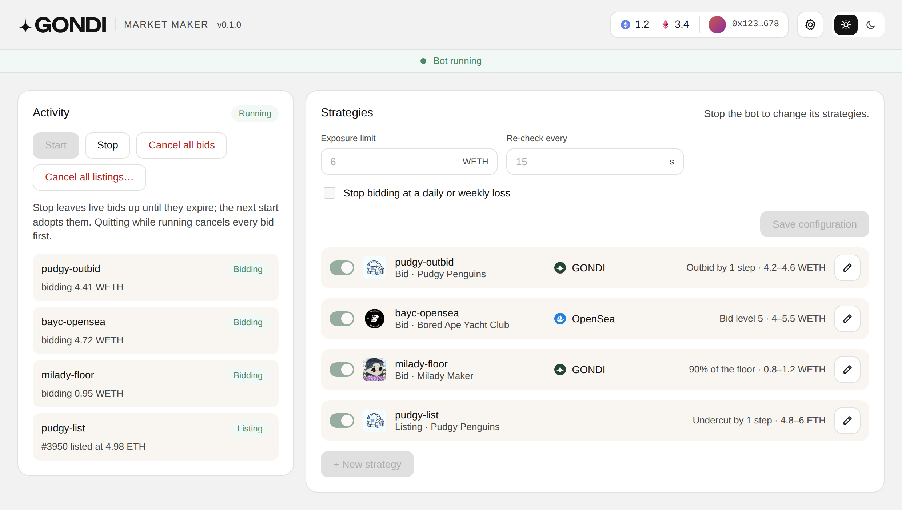

# GONDI Market Maker

A non-custodial market-making bot for NFT bids on [GONDI](https://gondi.xyz) and
[OpenSea](https://opensea.io). It keeps your bids competitive while you are away: it prices each
bid from the live order book, replaces it when someone outbids you, refreshes it before it expires,
and stops when a bid fills or the floor moves.

Your private key never leaves your machine. The bot signs orders and cancels bids off-chain, both
free; it never sends a transaction on its own.

It also keeps your listings competitive: it lists an item against the cheapest other listing in
its collection, lists again lower when someone undercuts you, and stops when the item sells.

> Status: early. Collection bids and single-item listings on Ethereum, from the command line or a
> desktop app for macOS and Windows.

**Use at your own risk.** The bot places real bids with the funds of the wallet you give it, and a
filled bid is a real purchase. It comes with no warranty (see `LICENSE`): start with a dedicated
wallet and small limits, and watch it before you leave it running.

<picture>
  <source media="(prefers-color-scheme: dark)" srcset="docs/screenshot-dark.png">
  
</picture>

## Features

- 🏪 **Two marketplaces**: collection bids on GONDI and on OpenSea, listings on GONDI.
- 🎯 **Bid strategies**: outbid the best bid by a step or a percent, bid a share of the floor or a
  few steps under it, join the Nth price level of the bid book, or hold a fixed price.
- 🏷️ **Listing strategies**: undercut the cheapest listing by an amount, list at a share of the floor, or at a
  fixed price; one item or everything the wallet holds in a collection.
- 🔁 **Hands-off**: reprices when someone outbids or undercuts you, refreshes bids before they
  expire, and picks up the bids it left after a restart.
- 🛡️ **Limits**: a min and max price per strategy, a total exposure cap, items or value to hold,
  a halt when the floor moves, and daily and weekly loss limits.
- 🧯 **Bad data guard**: it posts nothing while the book is crossed, such as under a dust listing.
- 🔐 **Non-custodial**: your key stays on your machine, encrypted by the system's secure storage.
  Bids are signed and cancelled off-chain, for free; only approvals send a transaction, and only
  when you confirm them.
- 🖥️ **Desktop app** for macOS and Windows, and a command line for servers, covered by the
  [command line guide](docs/command-line.md).

## Download

Download the latest desktop app for your computer:

Earlier versions are on the [Releases](https://github.com/gondixyz/market-maker/releases) page. To
open the app the first time:

- **macOS**: drag the app to Applications and open it; at "Apple could not verify", click Done, then
  System Settings → Privacy & Security → **Open Anyway**.
- **Windows**: at "Windows protected your PC", click **More info**, then **Run anyway**.

What changed in each release is in [`CHANGELOG.md`](CHANGELOG.md).

## License

MIT
